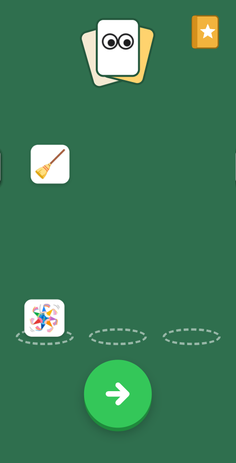
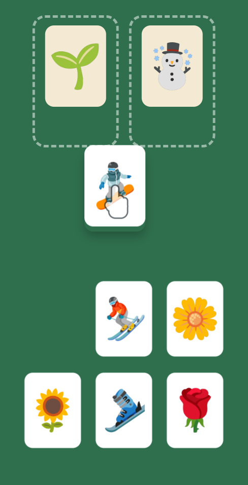
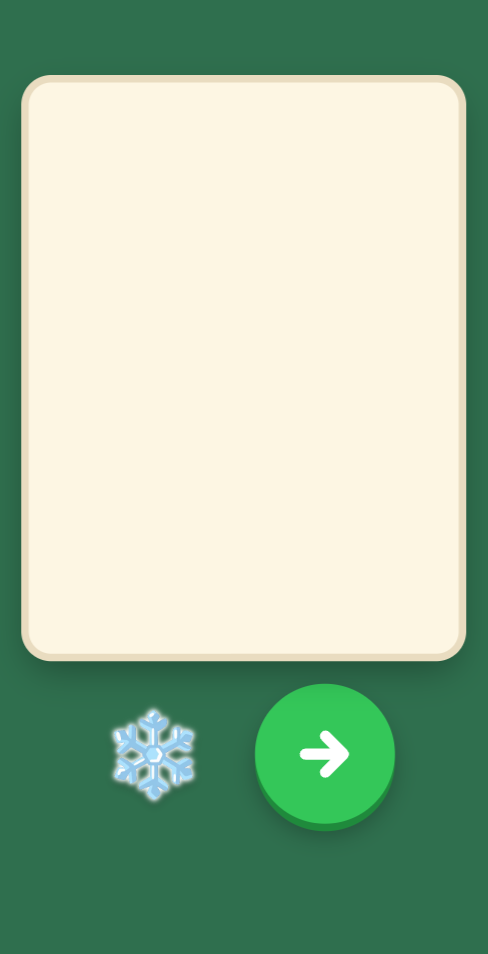

# 🃏 Pile Pals

**A picture sorting game for children of 4 and 5 years who cannot read yet.**
Drag each picture card onto the pile where it belongs. 🐶🐱 go with the pets, 🍎🍌 go with the fruit, and 🔴 goes with the red things.

👉 **Play now: [matteoantoci.github.io/pile-pals](https://matteoantoci.github.io/pile-pals/)**

<p align="center">
  
  &nbsp;
  
  &nbsp;
  
</p>

Pile Pals is a calm version of the adult game _Solitaire Associations: Words_, made for small hands. It has no text, no timer, no score, and no way to lose.

## ✨ What the child gets

- 🖐️ **Drag and drop that feels native.** Cards lift, follow the finger, snap onto the pile, and shake back after a wrong drop.
- 🎵 **Sound as feedback.** Each card on a pile plays the next note of a scale. Pals play real animal and vehicle sounds.
- 🎉 **Celebrations.** A finished group walks off the table in a parade, and a finished level gives confetti and a fanfare.
- 🌟 **A sticker book.** Each level gives a sticker. Gold stickers come later, and a full book makes all the pals dance.
- 👋 **A demo hand.** It shows each new action one time. When the child waits, the right card gives a small hop.
- 📈 **Levels that grow slowly.** Early levels have 2 piles and few cards. Later levels add face-down cards, a deck, and category cards that the child puts on empty slots.
- 🧩 **Many kinds of groups.** Kinds, colours, homes, things that go together, and how things move. Each level uses one kind only.

## 👪 For parents

- 📱 **Install it like an app.** On iPhone, open the game in Safari, tap **Share**, then **Add to Home Screen**.
- ✈️ **It works offline.** After the first open on Wi-Fi, the game plays in airplane mode.
- 💾 **It saves by itself.** The child comes back to the same table.
- 🔒 **Parent area.** Hold the logo for 3 seconds, then answer a multiplication question. Inside: sound on or off, export and restore of the save code, reset, and credits.
- 🔊 **Sound with the silent switch on.** The game uses the `playback` audio session, so the silent switch does not mute it. Use the sound switch in the parent area or the volume buttons.

## 🛠️ Development

You need Node 24 and pnpm (the version is in `package.json`).

```sh
pnpm install     # also turns on the pre-commit hook
pnpm dev         # dev server
pnpm build       # production build in dist/
pnpm check       # format, lint, type-aware lint, types, dependencies, tests
pnpm smoke       # build, then drive the main flows in headless Chrome
```

| Part    | Choice                                                                             |
| ------- | ---------------------------------------------------------------------------------- |
| UI      | [Solid](https://www.solidjs.com/) and TypeScript                                   |
| Build   | [Vite](https://vite.dev/) and [vite-plugin-pwa](https://vite-pwa-org.netlify.app/) |
| Motion  | Web Animations API, `transform` and `opacity` only                                 |
| Sound   | Web Audio, one `AudioContext`                                                      |
| Checks  | oxfmt, oxlint, tsc, knip, Vitest                                                   |
| Hosting | GitHub Pages, deployed by GitHub Actions on each push to `master`                  |

### 🗺️ Where things are

| Path           | What it holds                                                                                   |
| -------------- | ----------------------------------------------------------------------------------------------- |
| `src/model/`   | The headless game model: levels, moves, stickers, and the save. The tests use only this module. |
| `src/ui/`      | The board, the title scene, the sticker book, and the parent area                               |
| `src/sound/`   | The audio engine and the shipped sound levels                                                   |
| `src/shell/`   | Save, restore, updates, and the page lifecycle                                                  |
| `scripts/`     | The content pipeline, the audio pipeline, and the smoke run                                     |
| `docs/agents/` | Notes for coding agents, including the iPhone rules that Chromium cannot show                   |

## 🙏 Credits

| Content              | Source                                                                                | Licence    |
| -------------------- | ------------------------------------------------------------------------------------- | ---------- |
| 🖼️ Pictures          | [Noto Emoji](https://github.com/googlefonts/noto-emoji) by Google                     | Apache 2.0 |
| 🎞️ Animations        | [Noto Emoji Animation](https://googlefonts.github.io/noto-emoji-animation/) by Google | CC BY 4.0  |
| 🦦 Otter sound       | "Otters Squeaking.wav" by Motion_S, on Freesound                                      | CC BY 4.0  |
| 🔉 Other sounds (47) | [Kenney](https://kenney.nl/) Casino Audio and Freesound authors                       | CC0        |

The parent area lists every source and author. The game data for credits is in `src/credits.json`.

## 📄 Licence

No licence is chosen for the code yet, so all rights are reserved. The pictures, animations, and sounds keep their own licences from the Credits table. See [`public/pictures/LICENSE.txt`](public/pictures/LICENSE.txt) and [`public/animations/LICENSE.txt`](public/animations/LICENSE.txt).
